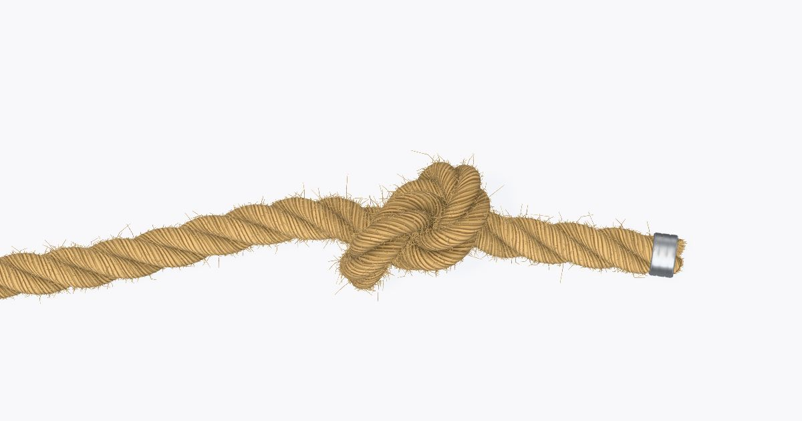
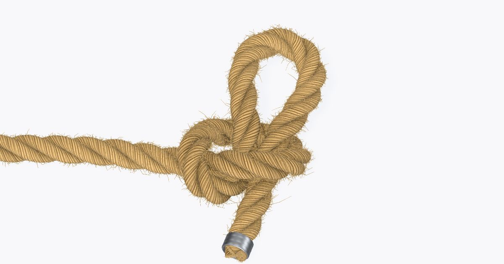
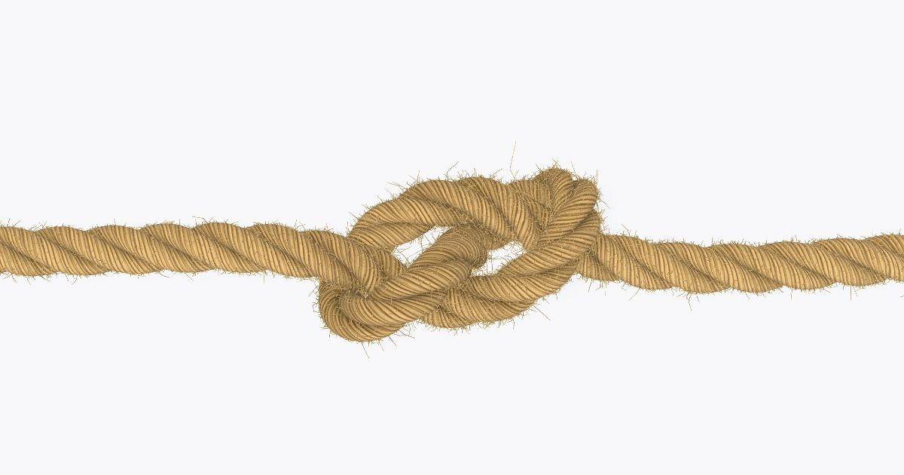
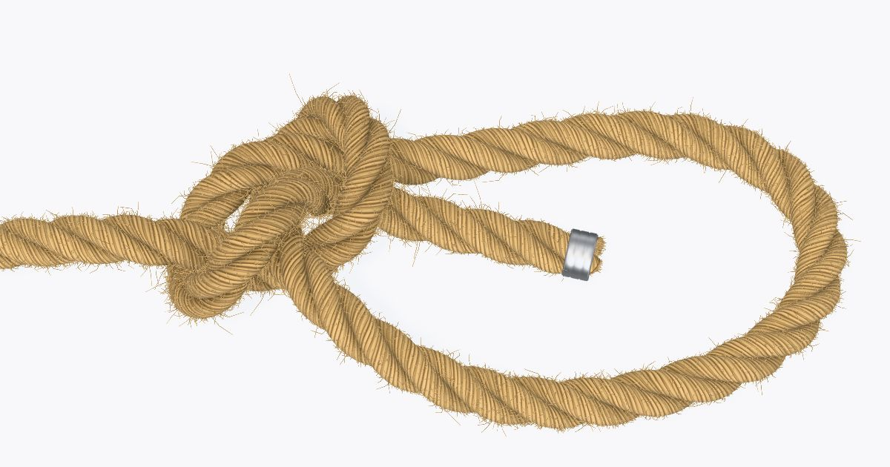
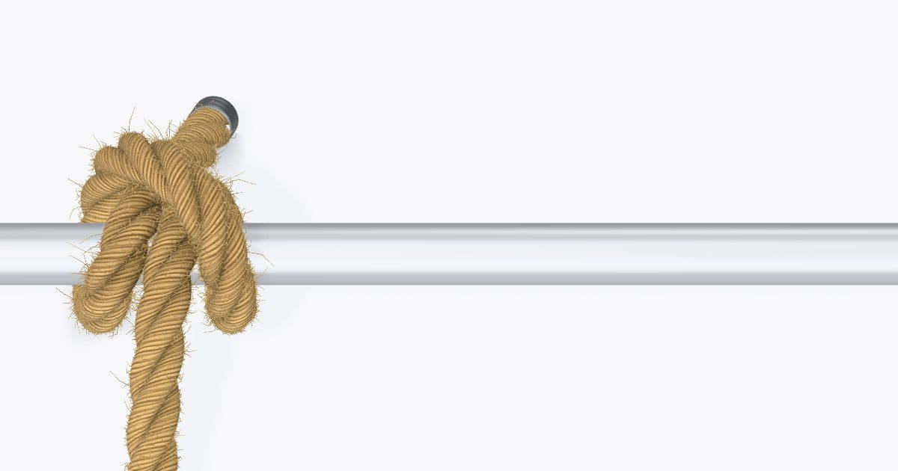
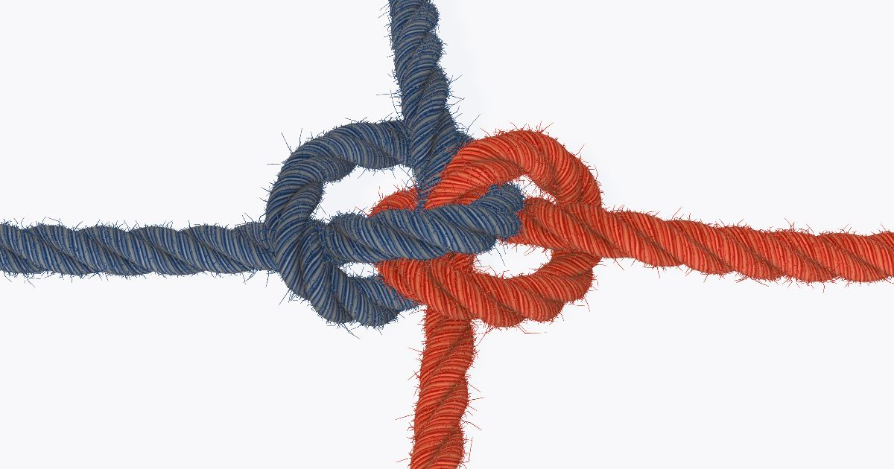
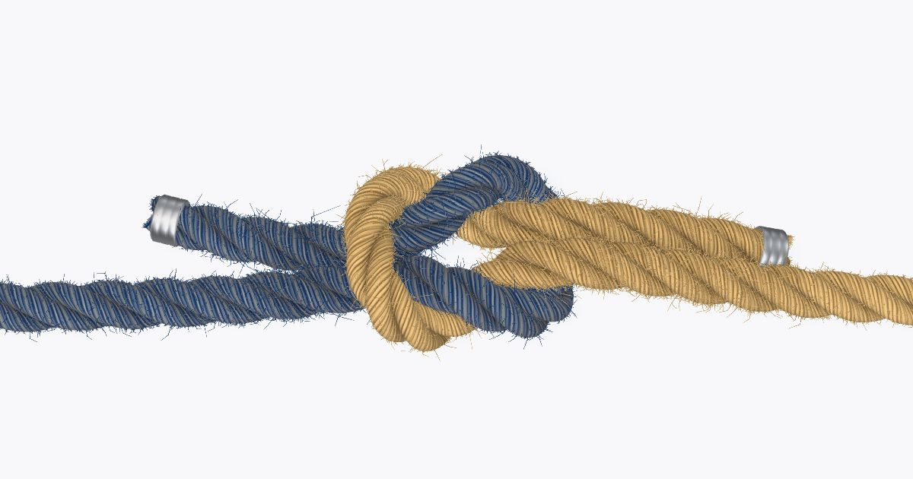
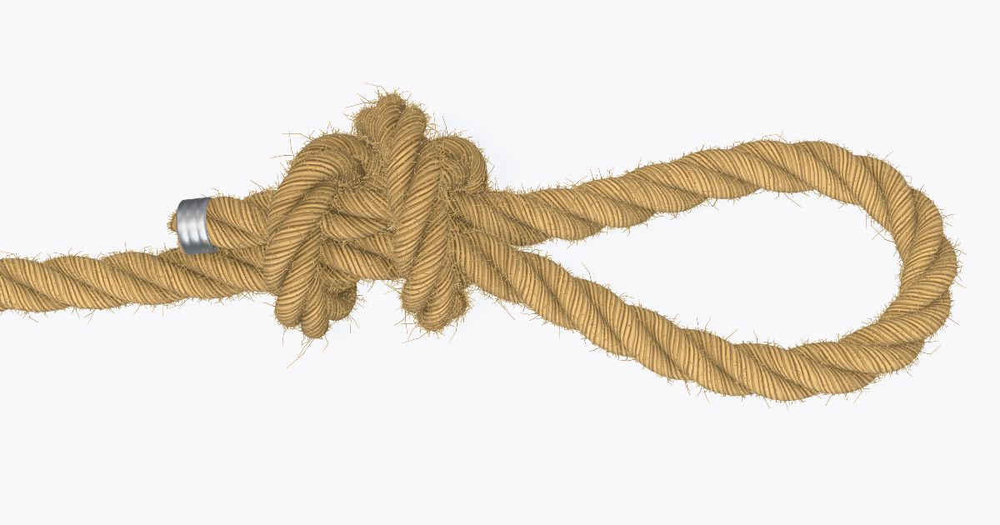
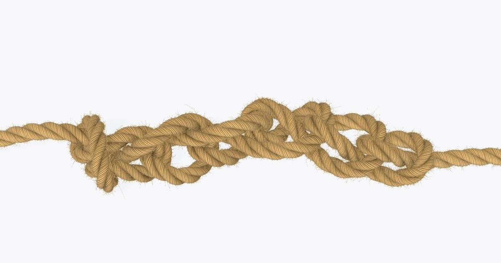

# Nudos sin vueltas

Mirá cómo se atan los nudos, paso a paso, con una soga simulada con física de verdad.

**[knots-made-easy.pages.dev](https://knots-made-easy.pages.dev)**

## Nudos

<table>
  <tr>
    <td align="center"><a href="https://knots-made-easy.pages.dev/nudos/nudo-simple/"><br>Nudo simple</a></td>
    <td align="center"><a href="https://knots-made-easy.pages.dev/nudos/nudo-corredizo/"><br>Nudo corredizo</a></td>
    <td align="center"><a href="https://knots-made-easy.pages.dev/nudos/nudo-de-ocho/"><br>Nudo de ocho</a></td>
  </tr>
  <tr>
    <td align="center"><a href="https://knots-made-easy.pages.dev/nudos/as-de-guia/"><br>As de guía</a></td>
    <td align="center"><a href="https://knots-made-easy.pages.dev/nudos/ballestrinque/"><br>Ballestrinque</a></td>
    <td align="center"><a href="https://knots-made-easy.pages.dev/nudos/nudo-zeppelin/"><br>Nudo Zeppelin</a></td>
  </tr>
  <tr>
    <td align="center"><a href="https://knots-made-easy.pages.dev/nudos/nudo-llano/"><br>Nudo llano</a></td>
    <td align="center"><a href="https://knots-made-easy.pages.dev/nudos/nudo-de-cazador-furtivo/"><br>Nudo de cazador furtivo</a></td>
    <td align="center"><a href="https://knots-made-easy.pages.dev/nudos/cadeneta/"><br>Cadeneta</a></td>
  </tr>
  <tr>
    <td align="center">🪢<br><b>Se están atando más nudos</b><br>Dale una estrella al repo para verlos primero</td>
  </tr>
</table>

## La soga de estrellas

Cada estrella en GitHub ata un nudo. Dale una estrella al repo y tu cara se suma a la soga.

[](https://knots-made-easy.pages.dev/estrellas/)

## Cómo correrlo

Necesita Node 22.22+ y pnpm.

```bash
pnpm install
pnpm dev
```

React, React Router y three.js, sin librería de física. [AGENTS.md](AGENTS.md) explica cómo encaja todo
y cómo agregar un nudo.
